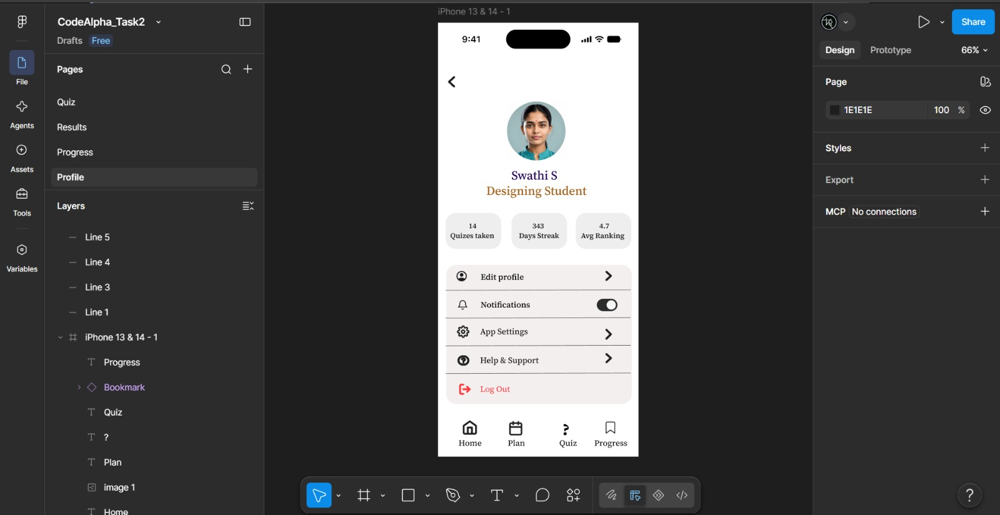
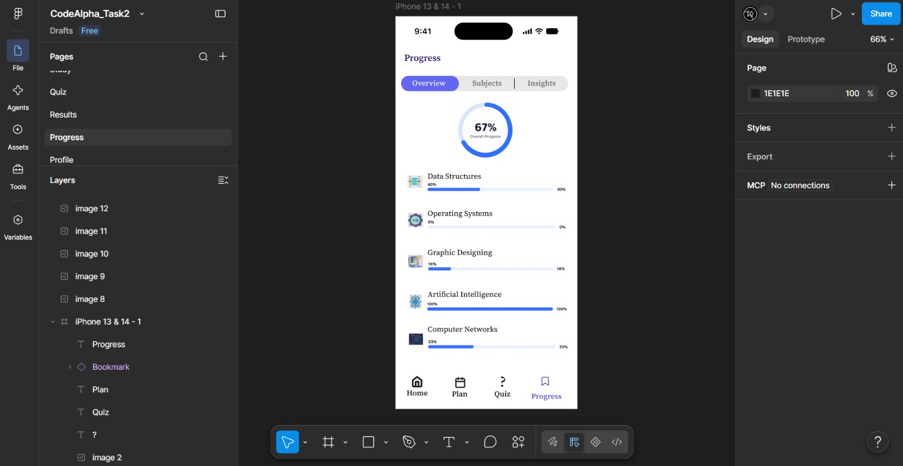
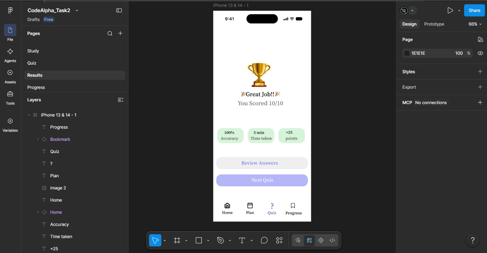
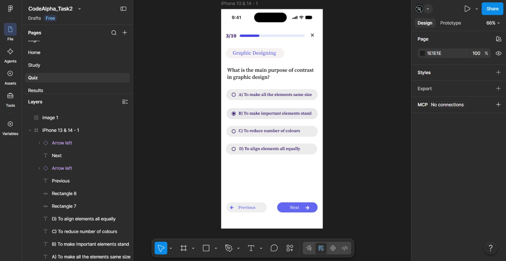
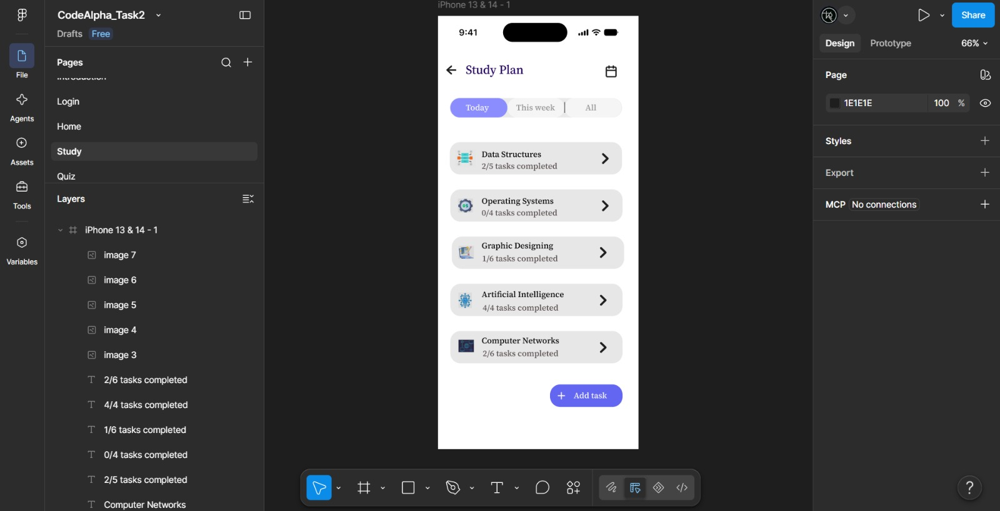
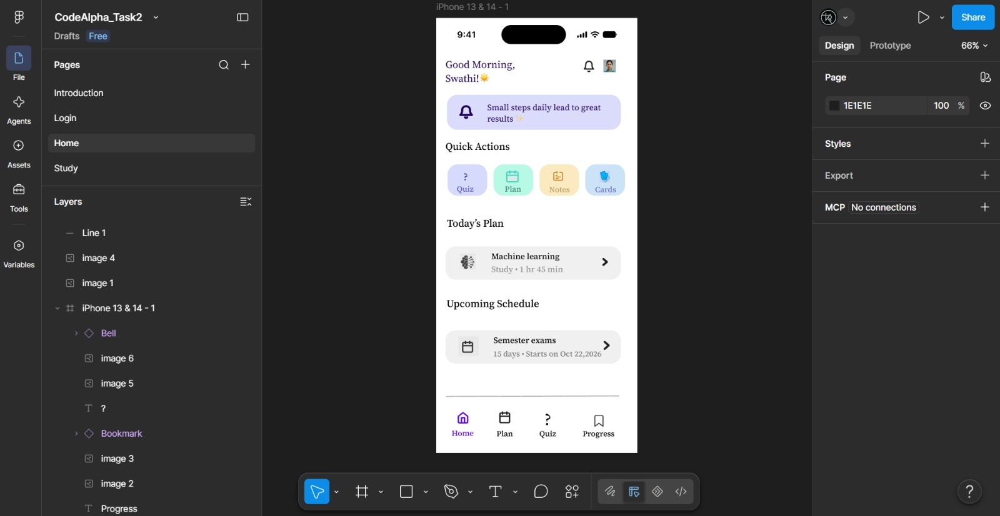
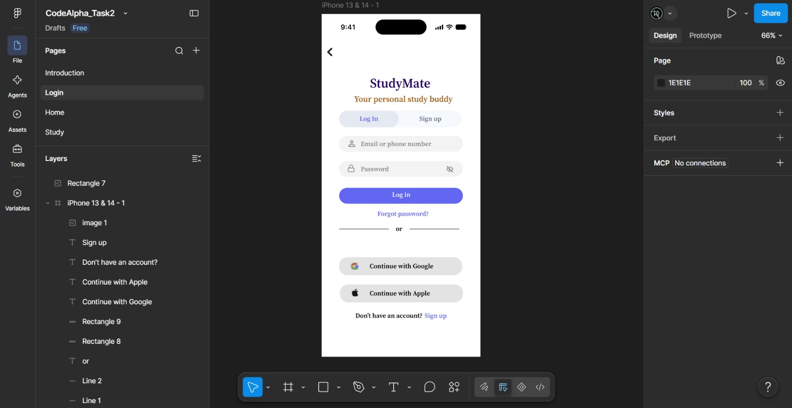
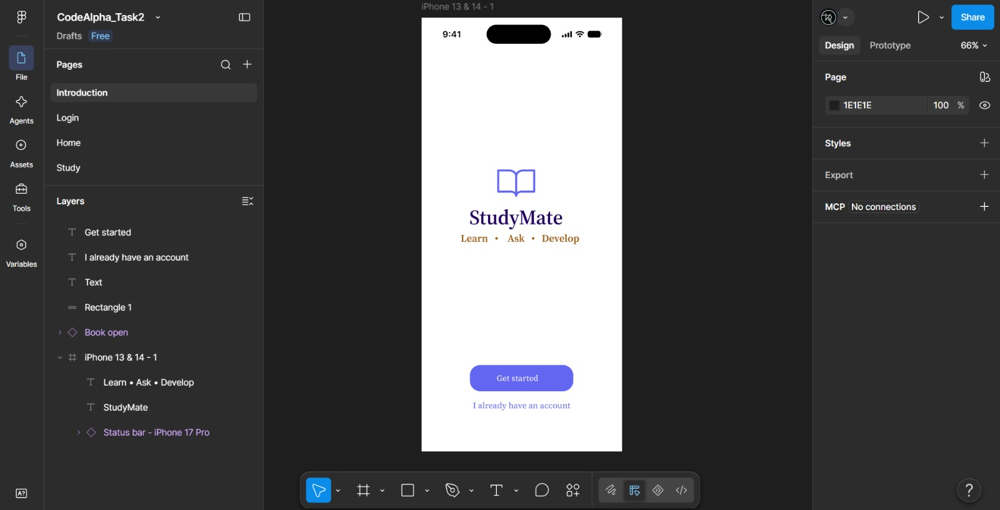

# Task 2 – UI/UX Design

## Overview

This project was completed as part of my UI/UX internship at CodeAlpha.

**## Design Screenshots**

### Profile Page

### Progress Page

### Results Page

### Quiz Page

### Study Page

### Home Page

### Login Page

### Introduction Page

[View the complete design on Figma]:(https://www.figma.com/design/CSrBAbxCwC9jynS6fgsLdT/TASK-2?node-id=0-1&t=Z0JJk733BmmFfcqt-1)
