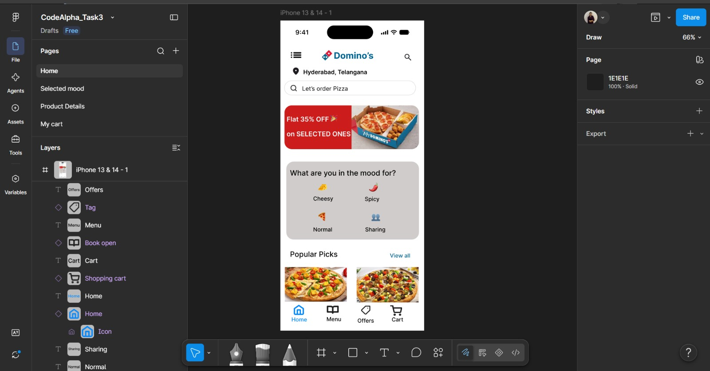
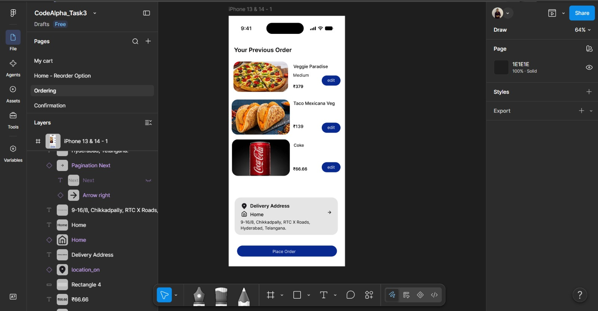
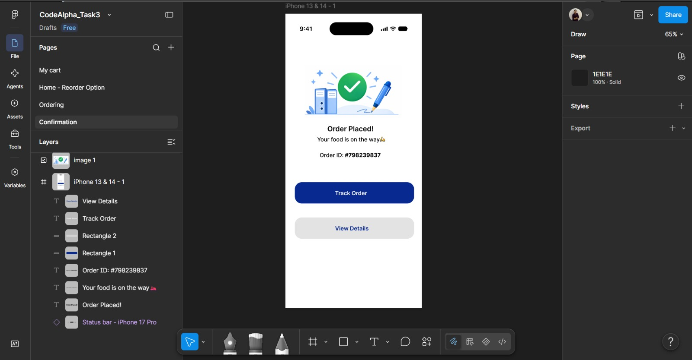

# Task 3 – UI/UX Design

## Overview

This project was completed as part of my UI/UX internship at CodeAlpha.

## Design Screenshots

### Home Page

### Selected Mood

### Product Detail Page

### My Cart

### Reorder Option

### Ordering Page

### Confirmation Page

### Presentation PDF

[📄 View or Download the Canva Presentation PDF](codealpha ppt.pdf)

## Design Files

[View the complete design on Figma] (https://www.figma.com/design/vp7In1X7VeDe5Bt16dvBsZ/CodeAlpha_Task3?node-id=3-491&t=NCbwij1ICDAqIsid-1)

## Canva Presentation

[View the Canva Presentation](https://canva.link/a6rbtgjv39wyhir)
